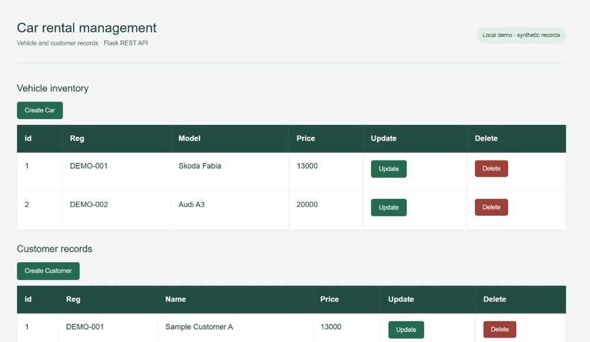

# Car rental management

A browser interface and REST API for managing vehicle and customer records.



**Python · Flask · MySQL · JavaScript**

[Visual case study](https://benjanning.github.io/projects/projects/car-rental/) · [Main portfolio](https://benjanning.github.io/projects/)

## What it does

Built a web application that connects a JavaScript interface to a Python API and relational database operations.

## Key features

- Vehicle and customer create/read/update/delete flows.
- Separate MySQL data-access classes and an explicit temporary synthetic store.
- Labelled form fields, integer-price validation and consistent missing-record errors.

## Run the synthetic local application

```powershell
python -m venv .venv
.venv/Scripts/python -m pip install -r requirements.txt
$env:DEMO_MODE="1"
.venv/Scripts/python CarServer.py
```
Open http://127.0.0.1:5000. On macOS/Linux use your virtual environment’s Python and `DEMO_MODE=1 python CarServer.py`.

## Technical details and verification

Run `python -m unittest discover -p "test_*.py"`: six test methods cover CRUD, invalid prices, missing records and the authentication boundary (with a stubbed data layer). Browser CRUD was exercised with synthetic records.

The MySQL path is retained but has not been integration-tested here. Set DB_HOST, DB_USER, DB_PASSWORD, DB_NAME, DEMO_USERNAME and DEMO_PASSWORD with DEMO_MODE unset. Database setup preserves existing data; use a disposable test database. This is a local academic prototype, not a production service.

[Original documentation and academic references](COURSEWORK.md) · [Visual provenance](assets/PROVENANCE.md)
