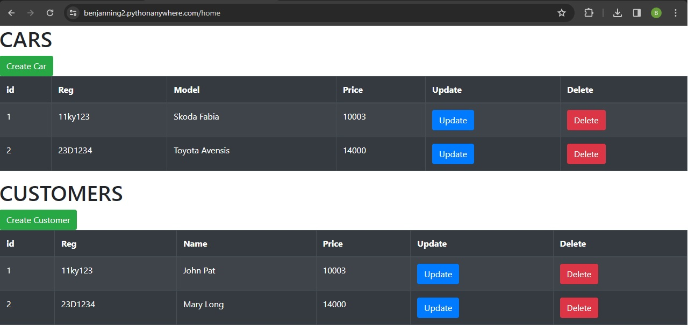

# Car Rental Management — Full-Stack Web Application

**Python · Flask · REST API · MySQL · HTML · JavaScript · AJAX**

An educational full-stack application with a browser interface and a Python API for working with **cars and customers** in a relational database.



## Why this project matters

Rather than analysing a dataset in isolation, this project brings together application structure, data persistence and user-facing workflows. It demonstrates how a frontend, API routes and SQL database fit together.

## Features in the coursework

- Flask server exposing car and customer endpoints.
- REST-style operations for creating, viewing, updating and deleting records.
- MySQL data access layer and database initialisation script.
- HTML and JavaScript frontend with asynchronous requests.
- Basic demonstration login mechanism.

## Architecture

```text
Browser interface (static/CarServer.html)
             │  HTTP / AJAX
             ▼
       Flask (CarServer.py)
             │
             ▼
    CarDao.py / CustomerDao.py
             │
             ▼
          MySQL database
```

## Project files

| File | Role |
| --- | --- |
| [CarServer.py](./CarServer.py) | Flask application and endpoints |
| [CarDao.py](./CarDao.py) | Car data operations |
| [CustomerDao.py](./CustomerDao.py) | Customer data operations |
| [createDatabase.py](./createDatabase.py) | Database setup |
| [dbconfig.py](./dbconfig.py) | Local MySQL connection settings |
| [static/CarServer.html](./static/CarServer.html) | Browser interface |
| [testCarDao.py](./testCarDao.py) | Data access exercises/tests |

## Run locally

1. Install Python and MySQL; create a virtual environment.
2. Install the packages in [requirements.txt](./requirements.txt) (`pip install -r requirements.txt`).
3. Set `DB_HOST`, `DB_USER`, `DB_PASSWORD` and `DB_NAME` for a **local test** MySQL server, plus `DEMO_USERNAME` and `DEMO_PASSWORD` for the example login. Do not use real credentials.
4. Run `python createDatabase.py`, then `python CarServer.py`.
5. Open the local URL printed by Flask.

A separate [PythonAnywhere deployment experiment](https://github.com/benjanning/deploytopythonanywhere) is also available. Its historical hosted demo may no longer be running.

**Security and maturity:** This is coursework code, not a production-hardened booking system. The demo authentication, input validation, configuration and error handling would need strengthening for real users. Do not deploy it with the example credentials.

---

Part of my Higher Diploma in Computing (Data Analytics). [View the full portfolio](https://github.com/benjanning/programming2022).
