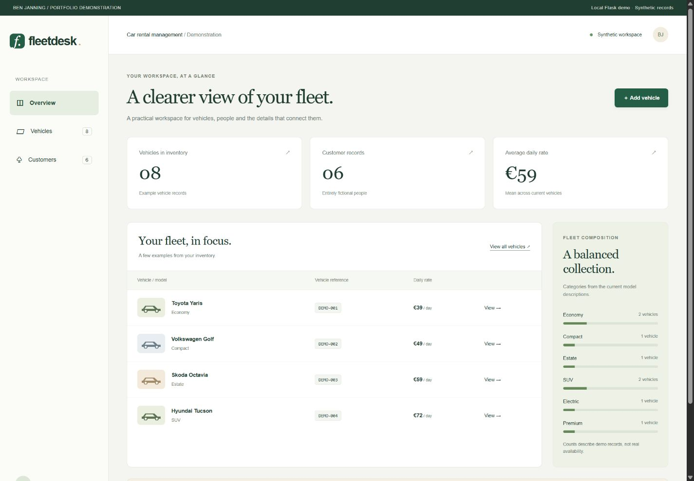
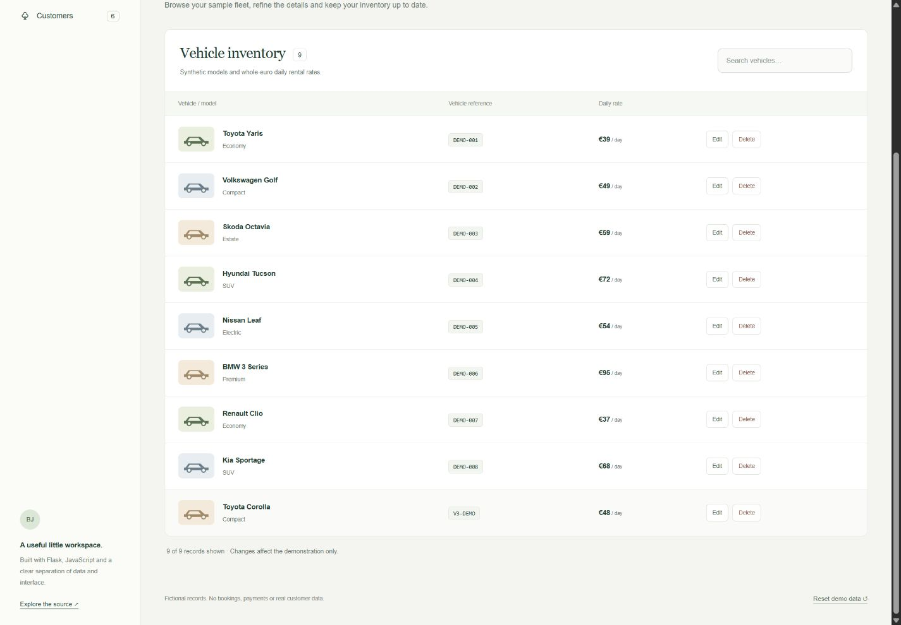
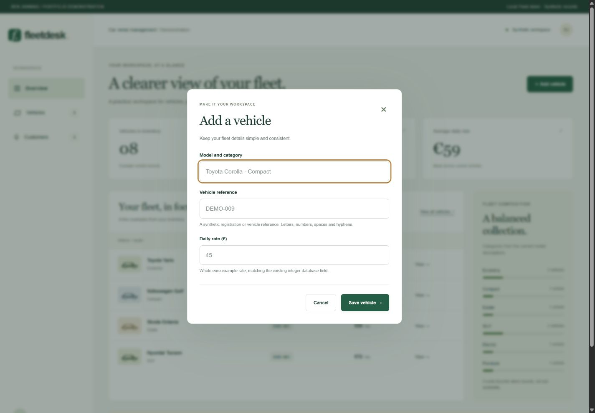
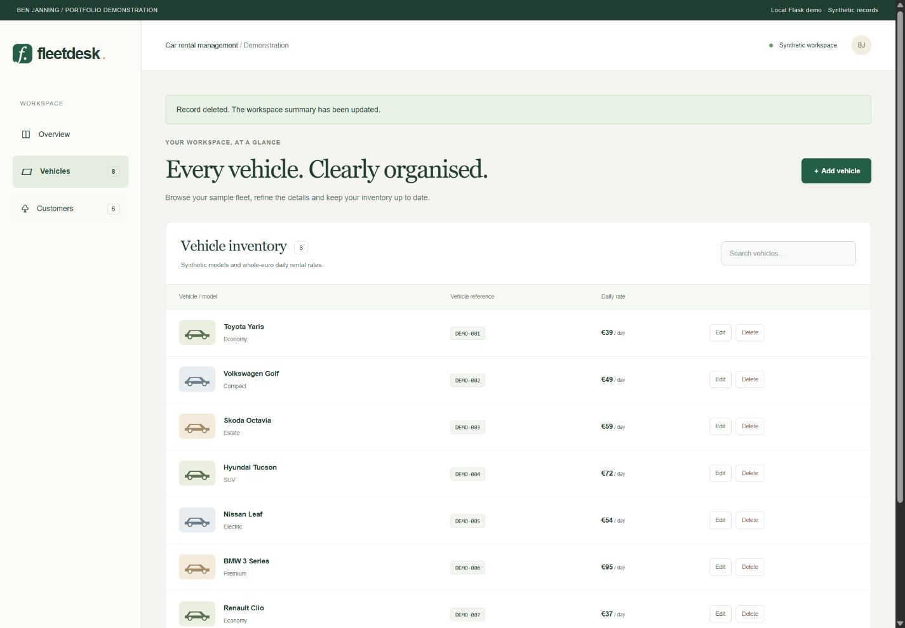

# Fleetdesk · Car rental management

A clear workspace for vehicle inventory and fictional customer records, developed from the original Flask/MySQL coursework.



**Python · Flask · REST API · MySQL · JavaScript**

[Visual case study](https://benjanning.github.io/projects/projects/car-rental/) · [Portfolio](https://benjanning.github.io/projects/)

## What you can explore

- Dashboard summaries calculated from eight sample vehicles and six fictional customers.
- Searchable vehicle and customer records, labelled editing forms and clear success/error feedback.
- Create, update, cancel and delete with confirmation; restore the sample workspace at any time.
- A shared frontend for the Flask API and a clearly labelled browser-storage demonstration.

No real rentals, payments or customer information. Customer vehicle references describe sample records; they do not create reservations or represent availability. The public static version does not run Flask or MySQL.

## Run the Flask demonstration

```powershell
python -m venv .venv
.venv/Scripts/python -m pip install -r requirements.txt
$env:DEMO_MODE="1"
.venv/Scripts/python CarServer.py
```

Open http://127.0.0.1:5000. On macOS/Linux, use your virtual environment's Python with `DEMO_MODE=1 python CarServer.py`. The server binds to loopback. Demo data is temporary and resets on restart or through **Reset demo data**.

## Screens from the application

| Inventory | Record form |
| --- | --- |
|  |  |
| Customer directory | Completed action |
|  |  |

## Architecture and data contract

The original `/cars` and `/customer` CRUD endpoints, identifiers and storage fields are preserved. `Price` is an integer whole-euro **example daily rate** in the refined demonstration; historical coursework used different example values. Categories are descriptive suffixes in the existing Model field, not a new database column. The synthetic dataset is shared by Python and the browser adapter.

The MySQL data layer uses lazy bounded pools, parameterized queries, transactions, rollback and connection cleanup. Set DB_HOST, DB_PORT, DB_USER, DB_PASSWORD, DB_NAME, DEMO_USERNAME and DEMO_PASSWORD with DEMO_MODE unset. Authentication protects database API access; cross-origin writes are rejected. Schema initialization is explicit. Use a disposable database, never real customer records. This is an educational prototype, without production tenancy or concurrency guarantees.

## Verify and reproduce visuals

```bash
python -m unittest discover -p "test_*.py" -v
python scripts/build-demo.py
npm ci
npm run test:rules
npx playwright install chromium
npm run test:browser
```

Thirteen local API/authentication regression tests pass; the live MySQL test is opt-in. The release workflow also runs MySQL 8.4 in an isolated CI service, verifies both browser adapters, captures deterministic screenshots and only then publishes evidence. Consult the linked workflow run for the actual database/browser result of a released revision. The browser failure test deliberately simulates a server outage; it does not claim an uncontrolled outage occurred.

The opt-in MySQL test refuses any database name other than `portfolio_integration`. It creates two isolated tables, exercises both CRUD resources and authentication, and removes its synthetic test records. Run it only with RUN_MYSQL_TESTS=1 and disposable DB_* / DEMO_* configuration.

`docs/` is generated from the shared frontend. The release workflow builds and deploys the tested static version, then makes source-identified metadata and genuine screenshots available for the central portfolio's review-PR synchronisation. No cross-repository write credential is used.

[Historical coursework documentation](COURSEWORK.md) · [Visual provenance](assets/PROVENANCE.md) · [Release checks](https://github.com/benjanning/data-representation-project/actions/workflows/portfolio-release.yml)
