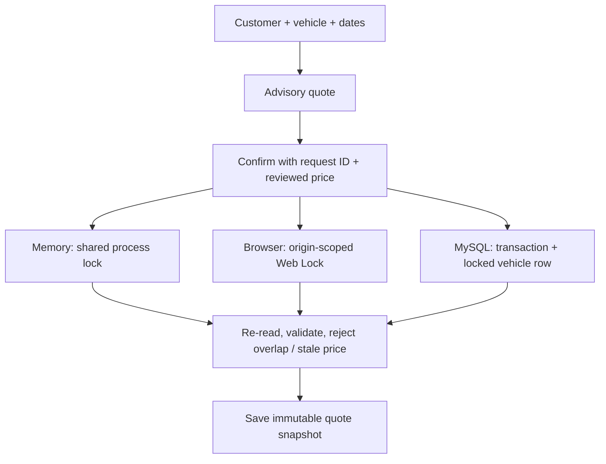

# Rental allocation decisions

The useful problem is allocating a particular vehicle to a customer for a period, rather than only editing vehicle records. The V4 extension adds this as a separate aggregate while preserving the original `/cars` and `/customer` fields and routes.

## Contract

- UTC calendar dates, collection included and return excluded. Adjacent reservations may share a handover date. Collection must be today or within 365 days; a rental lasts 1–365 days.
- Current vehicle `Price` is a whole-euro daily rate; quotes and saved totals use integer cents. `days × daily_rate_cents` is the entire example price. No tax, deposit or payment is added.
- Quote checks are advisory. Confirmation re-reads the vehicle/customer and checks allocation and rate within the write transaction. A changed rate returns `409 quote_changed` and requires review of a fresh quotation.
- Each create carries a request ID. Retrying the identical selection and quoted amounts returns the same record; a different payload cannot reuse that ID. Retrying a cancelled record never reactivates it.
- Confirmed periods block overlaps. Cancellation releases allocation and preserves history. Completion is allowed only on/after the scheduled return date. There is no early-return/prorating model. Terminal statuses cannot be reversed.
- Names, vehicle details and rates are snapshots. Subsequent record edits do not rewrite saved quotations. Referenced vehicle/customer rows cannot be deleted, including after cancellation/completion; removing history is outside this demo.
- Sample reservations use shared relative-date specifications. Reset restores eight vehicles, six customers and three reservations (active, upcoming and return due). Existing browser V3 vehicle/customer edits are imported with an empty reservation history. MySQL migration adds an empty reservation table and preserves existing records.

## Preventing simultaneous overlap

Memory CRUD/reset and reservations share one reentrant lock. Browser mutations acquire one exclusive Web Lock, reload the latest local data and persist once; storage events refresh other tabs. MySQL creates lock the vehicle and customer rows before reading overlaps, and commit the allocation in the same READ COMMITTED transaction. Status changes lock the same vehicle before the reservation row. Foreign keys prevent dangling references. Connections/cursors are released on success and rollback. A unique case-sensitive request ID protects retries.

Browser data belongs only to that origin/browser profile. Web Locks do not coordinate other devices; browsers lacking the API cannot mutate this demo safely and receive an explicit message. The MySQL guarantee assumes reservation writes use this service. Basic authentication remains required in local non-demo mode, with credentials supplied through environment variables. There is no deployed multi-user backend, real fleet, payment processor or production audit/identity system.

## API additions

| Method | Route | Result |
| --- | --- | --- |
| GET | `/api/reservations` | Saved snapshots and statuses |
| POST | `/api/reservations/quote` | Current date-based quote or useful 400/404/409 |
| POST | `/api/reservations` | 201 allocation, or 200 identical retry |
| POST | `/api/reservations/<id>/status` | Cancelled/completed, subject to transition rules |
| GET | `/api/availability?start_date=YYYY-MM-DD&end_date=YYYY-MM-DD` | Advisory per-vehicle availability |

Quote payload: `vehicle_id`, `customer_id`, `start_date`, `end_date`. Creation additionally requires `request_id`, `quoted_daily_rate_cents`, `quoted_total_cents`. Errors include a human-readable `error` and stable domain `code`; database diagnostics are not exposed. Existing authentication and cross-origin-write checks apply to the new API.

The dashboard counts actual records and reservations. Available vehicles use its selected interval; active/upcoming/return-due use today in UTC. Confirmed example value sums all currently confirmed snapshots, including returns awaiting completion, and is explicitly not revenue. With the reset seed it is €480 (4×€39 + 3×€49 + 3×€59).

## Evidence

Python tests exercise date boundaries, leap days, price tampering and changes, immutable snapshots, state transitions, reset, references and two simultaneous allocation attempts. The browser rules are checked against 27 deterministic Python contract cases. Browser journeys cover both adapters, overlapping quotes, history, mobile layout, simultaneous tabs and a retry after the server committed but its response was lost. Disposable MySQL tests verify actual row-lock contention, foreign-key deletion rejection, snapshots, retries, cancellation and completion.

Implementation references: [Web Locks API](https://developer.mozilla.org/en-US/docs/Web/API/Web_Locks_API), [MySQL locking reads](https://dev.mysql.com/doc/refman/8.4/en/innodb-locking-reads.html). The tests verify the implemented contract; a finite parity corpus is not a proof of every possible input.
